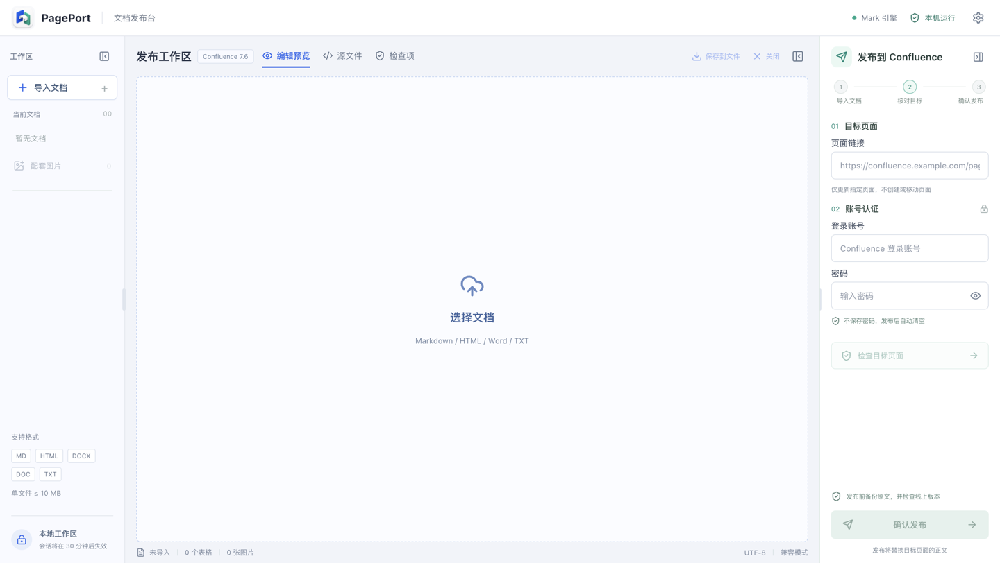

# PagePort


Mac 上的本地 Confluence 文档发布工具。

PagePort 是基于 [Mark](https://github.com/kovetskiy/mark) 的 macOS 文档发布台：
导入 Markdown、HTML、Word 或纯文本，核对近似预览，再检查目标页面、备份和发布。
它面向支持 REST API 与账号密码认证的 Confluence Server / Data Center。
不需要把密码写进 Markdown，也不需要让密码出现在命令行参数中。
转换引擎内置，文档和密码不经过第三方发布服务器。Mac 能访问公司 Confluence 即可使用。



## Mac 安装

从 GitHub Releases 下载对应芯片的安装包，打开 DMG，把 PagePort 拖入“应用程序”。
当前首版提供 Apple Silicon（M 系列）版本，Intel 用户可以在对应 Mac 上从源码构建。
应用未使用 Apple 开发者证书签名、公证；首次启动可能需要在系统设置
“隐私与安全性”中确认允许打开。不要为了安装关闭整个系统的安全检查。

打开应用即可工作，无须终端、API Key 或网站访问口令。
“PagePort → 打开备份文件夹”可查看本机原页面备份。

## 工作流

1. 打开 PagePort，进入本地工作区。
2. 导入 `.md` / `.markdown` / `.html` / `.htm` / `.docx` / `.txt`。
3. Markdown 引用本地图片时，同时添加对应 PNG、JPEG、GIF 或 WebP 文件。
4. 在“编辑预览”中直接修改，或切换 Markdown 源文件。修改自动转换为发布稿；等待“发布稿已同步”，核对“发布预览”与检查项。
5. 输入已有页面的完整 HTTPS 链接、Confluence 账号和密码。
6. 检查目标标题、版本与原正文，必要时下载备份。
7. 输入目标标题并确认。系统先备份原文，再用版本号保护更新，并回读核对正文结构。

只更新已有页面，不自动创建页面、移动页面或合并原文。
更新会替换完整正文；已有宏、原图片引用、任务及其他原文结构不会自动保留。
检测到行内评论时拒绝更新。页面历史由 Confluence 自身保留。

## 格式边界

| 内容 | 行为 |
| --- | --- |
| 标题、强调、列表、链接、普通表格 | 转换并保留支持的结构 |
| HTML 合并单元格 | 保留 `rowspan` / `colspan`，最终宽度依赖 Confluence |
| 代码块 | 纯文本 `<pre><code>`，避免旧版代码宏语言参数不兼容 |
| 本地 / Word 内嵌图片 | 校验实际类型，上传为内容哈希命名的附件 |
| 外部图片 | 不自动抓取，缺图阻止发布；可手动提供同名图片 |
| Word 字体、分页、浮动布局、修订和批注 | 不保证还原，应核对转换结果 |
| HTML 脚本、样式、表单、iframe、专有宏 | 清理，不执行 |
| PDF、旧版 `.doc`、PPT、Excel | 暂不支持，不伪装成成功转换 |

预览是近似样式，不是 Confluence 官方渲染器。不承诺任意格式逐像素无损。
回读核验比较文字与表格、行、图片数量，不代表视觉排版完全一致。
当前转换规则为 Confluence 7.6 系列设计，自动化测试使用真实 Mark 和模拟 REST 服务。
不同 Confluence 版本、插件及账号策略仍需在独立测试页实测。

## 可视化编辑（0.2）

默认视图为基于 TipTap / ProseMirror 的可编辑预览，按 Typora 的常用写作格式提供工具栏：
六级标题、加粗、斜体、下划线、删除线、高亮、上下标、行内代码、代码块、
有序/无序/嵌套/任务列表、引用、分隔线、对齐、链接、图片与表格。
表格支持增删行列、表头切换和选择多个单元格后的合并/拆分。
支持 Markdown 输入规则、撤销重做、大纲跳转及专注模式。

- 点击正文即可编辑，常用快捷键如 `Cmd+B`、`Cmd+I`、`Cmd+Z` 可用。
- 插入图片支持选择、粘贴和拖入本地文件；不抓取远程图片。
- “发布预览”为只读近似效果，基于后端实际转换结果；不是当前光标所在的编辑页面。
- Markdown 源码与可视化视图同步。编辑期间立即失效原发布确认，不允许发布旧稿。
- `Cmd+S` 或右上角下载图标导出 Markdown。不会静默覆盖原文件。关闭或替换未导出文档时提示确认；没有持久化草稿恢复。
- Word / HTML 导入后也可编辑，但编辑器会按支持的结构规范化，不保证任意原始 HTML 无损。缺图文档先补图或修复源码，避免把占位符误发为正文。
- 合并表格、对齐和扩展文字样式以 HTML 混合 Markdown 导出，避免标准 Markdown 无法表达的格式被丢弃。

这不是完整 Typora 克隆。数学公式、Mermaid、脚注、任意 HTML/CSS、字体选择、
分页和代码语法高亮暂不提供；公式与 Mermaid 输入只保留源码，并给出兼容性提示。
任务列表转换为 Confluence 原生任务结构，高亮转换为背景色；旧版 Confluence 最终显示仍应在测试页核对。

## 正文目录（0.3）

将光标放到正文中的插入位置，点击工具栏“插入目录”图标。
目录随章节标题自动更新，点击条目可跳到标题；可选起始和结束标题层级（1–6）。
目录自身不作为标题收录。已有的章节编号原样显示，不自动给标题编号。

Markdown 源码也支持单独一行 `[TOC]`，代码块中的同名文本不会生成目录。
可视化编辑和导出时使用带层级设置的 `<div data-pageport-toc="true" ...></div>` 标记。
本地“发布预览”渲染可点击目录，真正发布时转换为 Confluence 原生 `toc` 宏，
不是把本地目录的静态链接复制到线上。通用宏仍被清理，不接受任意宏执行。

当前发布模式始终为“替换目标页完整正文”，不是追加，也不是只更新某个章节。
页面 ID、标题、父子位置和权限不主动修改；替换正文不会自动保留原正文中的表格、图片引用或宏。
原附件文件不主动删除，旧图片若不在新正文中引用就不再显示。子页面不随正文一起更新。
新增本地图片作为附件上传。发布前备份原文、检查版本冲突并要求输入页面标题确认。

## 从源码构建 Mac 应用

要求 macOS、Node.js 22.16+ 及 Xcode 命令行工具。

```sh
npm ci
npm run prepare:mac
npm test
npm run desktop
# 生成 DMG 和 ZIP，输出到 release/
npm run package:mac
```

`prepare:mac` 按本机架构下载固定版本 Mark，校验官方 SHA-256，并生成应用图标。
Mark 二进制不提交到 Git。`package:mac` 默认构建本机架构。
运行数据位于 `~/Library/Application Support/PagePort/data`（实际名称以应用为准）。
发布前的备份位于其中的 `backups` 子目录；退出应用会清除内存中的会话及文档。

## 可选 Web 模式

要求 Docker Compose、可访问的 Confluence，以及 HTTPS 反向代理。

```sh
cp .env.example .env
# 修改 .env：允许的公司域名、随机网站访问口令、本站 HTTPS 地址
docker compose up -d --build
```

默认仅监听宿主机 `127.0.0.1:18418`。反向代理示例见
[deploy/nginx.conf](deploy/nginx.conf)。必须配置可信证书，禁止在公网使用明文 HTTP。

`ACCESS_PASSWORD` 是网站独立访问口令，至少 16 字符，不是公司账号密码。
`CONFLUENCE_HOSTS` 为管理员维护的精确域名白名单，逗号分隔。
不接受任意发布地址、HTTP、用户信息或非标准端口；不跟随上游跳转。
白名单属于信任配置，应只指向管理员信任的 Confluence，禁止配置不可信 DNS。
发布服务器必须能访问目标 Confluence。浏览器能访问公司内网不代表公网服务器也能访问。
内网站点请把 PagePort 部署在内网，或使用经企业批准的 VPN；本项目不自动建立内网隧道。
仅支持直接的 Basic Auth；SSO、验证码或企业策略可能要求其他官方认证方式。
Confluence Cloud 账号密码登录不适用。

## 本地开发

Node.js 22.16+，以及 PATH 中的 Mark 16.22.0。

```sh
npm ci
cp .env.example .env
# 本地开发可移除 PUBLIC_URL 和 TRUST_PROXY，设置允许的测试域名
npm run dev
# http://localhost:4318
npm test
npm run build
```

`MARK_BIN` 可指定可信 Mark 可执行文件路径。Docker 自动安装校验 SHA-256 的固定版本。

## 安全与数据

- Confluence 凭据仅在浏览器当前内存及服务端请求内存中用于认证，不落盘、不写日志、不放入进程参数。
- Mac 应用仅在随机本机端口运行服务，使用每次启动生成的私密请求凭证，不允许普通浏览器或其他网页访问。
- 应用窗口禁用 Node 集成、启用上下文隔离与沙箱，采用非持久化浏览器会话。
- 文档和预览仅保留在本机短期内存会话，30 分钟到期，重启清除；每个会话仅保留当前文档。
- 原页面备份持久化到应用数据目录，含公司正文，但不含认证密码。可选 Docker 模式存放于 `/app/data/backups`。
- 自动备份不等于完整站点备份：不包括历史附件、页面权限、评论和全部历史版本。
- 管理员必须限制备份访问，按公司要求定期离线归档或删除；本版本不自动清理备份。
- 同源 CSRF 保护、HttpOnly Cookie 和限流启用；可选 Web 模式必须使用访问口令和 HTTPS。
- 上传限 10 MB/文件，合计 20 MB；单图 6 MB、最多 24 张；DOCX 解压 45 MB / 2000 条目。
- 转换在限时工作线程执行，最多两项同时转换；容器资源受限。发布冲突或结果不确定时不自动重试。

Web 生产环境启动时必须提供访问口令；Mac 应用自动管理临时本机凭证。
不要把 `.env`、备份或真实文档提交到仓库。
详细威胁边界与依赖审计见 [SECURITY.md](SECURITY.md)。

## 开源

PagePort 自有代码采用 MIT 协议，Mark 与其他依赖保留各自协议。
见 [THIRD_PARTY_NOTICES.md](THIRD_PARTY_NOTICES.md)。
欢迎提交格式兼容性样例，请先移除公司正文、个人数据与账号信息。

---

PagePort is a local-first macOS Confluence publisher powered by Mark.
Import Markdown, HTML, DOCX or text; review a sanitized approximate preview;
inspect and back up an existing page; then explicitly confirm a version-protected
update. Mark is bundled; documents and passwords stay on your Mac until sent
directly to your chosen Confluence instance. Passwords are transient, not stored.
Fidelity is structural, not pixel-perfect. An optional self-hosted web mode is
available for trusted infrastructure.
