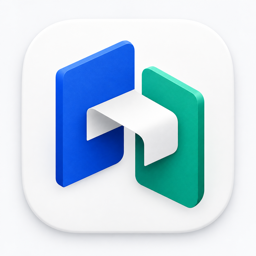

# PagePort



Mac 和 Windows 上的本地 Confluence 文档发布工具。

官网与安装包：[pageport.chopperh.me](https://pageport.chopperh.me)。

下载页采用桌面优先的蓝白布局，选择 macOS / Windows 后共用同一个下载按钮，版本、文件大小与 SHA-256 随系统同步切换；提供四步发布演示、格式兼容说明与安装指南，GitHub Releases 可作为备选下载源。

PagePort 是基于 [Mark](https://github.com/kovetskiy/mark) 的本地文档发布台：
导入 Markdown、HTML、Word 或纯文本，核对近似预览，再检查目标页面、备份和发布。
它面向支持 REST API 与账号密码认证的 Confluence Server / Data Center。
不需要把密码写进 Markdown，也不需要让密码出现在命令行参数中。
转换引擎内置，文档和密码不经过第三方发布服务器。电脑能访问公司 Confluence 即可使用。


## Mac 安装

从 GitHub Releases 下载对应芯片的安装包，打开 DMG，把 PagePort 拖入“应用程序”。
当前首版提供 Apple Silicon（M 系列）版本，Intel 用户可以在对应 Mac 上从源码构建。
应用未使用 Apple 开发者证书签名、公证；首次启动可能需要在系统设置
“隐私与安全性”中确认允许打开。不要为了安装关闭整个系统的安全检查。

打开应用即可工作，无须终端、API Key 或网站访问口令。
顶部“本机备份”或菜单“PagePort → 打开备份文件夹”可查看本机原页面备份；侧栏“导入文档”旁的按钮可新建空白文档。

## Windows 安装

从 [GitHub Releases](https://github.com/chopperH0824/pageport/releases) 下载
`PagePort-版本-x64-setup.exe`，在 Windows 10/11 x64 上运行安装向导。
默认按当前用户安装，可以选择安装目录；安装向导完成页默认勾选「安装完成后删除安装包」，完成安装后会自动清理安装文件（取消安装时不会删除）。首版不提供 Windows ARM64 原生包。
在 SignPath Foundation 开源代码签名证书生效前，Windows 可能显示未知发布者或 SmartScreen 提示；
请先核对来源与发布页 SHA-256 摘要，再点击「更多信息 → 仍要运行」，不要关闭系统安全保护。

Windows 支持 Markdown、HTML、DOCX、TXT、Confluence 网页导出的 Word，
以及实际为 DOCX 结构的 `.doc`。真正的旧二进制 `.doc` 需先在 Word
另存为 `.docx`；Mac 继续通过系统 `textutil` 转换。Windows 不要求安装 Go、Node 或 Word。
快捷键使用 `Ctrl`，Mac 使用 `Cmd`。

## 检查更新

安装后，启动约 10 秒及运行期间每 6 小时检查一次最新正式版本。
检查优先请求 GitHub API；在国内网络常见 API 限流、超时或被拦截时，自动改用官方镜像
`https://pageport.chopperh.me/downloads/latest.json`。镜像返回的版本、来源链接、安装包文件名、
大小与 SHA-256 都会校验，安装包下载完成后仍会做完整摘要核对。
也可使用应用菜单“PagePort → 检查更新…”或右上角“设置 → 软件更新”。
后台检查只显示新版本标记，不弹窗打断编辑；网络失败不影响工作。
更新窗口可关闭自动检查，手动检查仍然可用。

窗口显示版本、日期和更新说明，按当前系统和架构选择安装包。
下载完成后核对 GitHub 提供的文件大小及 SHA-256，再允许在 Finder/资源管理器中查看。
「发布页」打开 https://pageport.chopperh.me/#download 。没有匹配安装包或可信摘要时也只打开这个下载页，不执行未经校验的文件。
安装前请保存文档并正常退出应用，然后运行 Windows 安装包或用 DMG 替换 Mac 应用。
不会静默安装、强制重启或清除页面备份。

只有发布新的正式 Release（更高版本 tag，附上对应安装包）才会提示更新；
仅推送源码、草稿和预发布不会。0.3.x 没有检测代码，旧用户需要先手动安装一次 0.4.0。
检查仅请求公开版本信息，不发送文档、Confluence 地址、账号、密码或用户标识；
连接 GitHub 仍会暴露网络连接常规信息（如 IP）。应用关闭时无法提醒。

## 工作流

1. 打开 PagePort，进入本地工作区。
2. 导入 `.md` / `.markdown` / `.html` / `.htm` / `.docx` / `.doc` / `.txt`（旧格式限制见上）。
3. Markdown 引用本地图片时，同时添加对应 PNG、JPEG、GIF 或 WebP 文件。
4. 在“编辑预览”中直接修改，或切换 Markdown 源文件。修改自动转换为发布稿；等待“发布稿已同步”，核对“发布预览”与检查项。
5. 输入已有页面的完整 HTTPS 链接、Confluence 账号和密码。
6. 检查目标标题、版本与原正文，必要时下载备份。
7. 输入目标标题并确认。系统先备份原文，再用版本号保护更新，并回读核对正文结构。

只更新已有页面，不自动创建页面、移动页面或合并原文。
更新会替换完整正文；已有宏、原图片引用、任务及其他原文结构不会自动保留。
检测到行内评论时拒绝更新。页面历史由 Confluence 自身保留。

## 格式边界

### 钉钉在线文档

在有权限的钉钉文档中复制正文，粘贴至 PagePort 空白工作区或编辑器；
也可导出 DOCX / Markdown 后导入。支持识别导出内容中明确标记的提示块、状态与任务，
并保留支持的表格跨度和底色。不同版本未保留语义的专有组件需手动核对。
不读取登录态、不通过分享链接抓取，不自动下载私有图片。Markdown 配套图片应同时导入。
公式、流程图、评论和附件不保证还原，请先在独立测试页验证。

| 内容 | 行为 |
| --- | --- |
| 标题、强调、列表、链接、普通表格 | 转换并保留支持的结构 |
| HTML 合并单元格 | 保留 `rowspan` / `colspan`，最终宽度依赖 Confluence |
| 代码块 | 纯文本 `<pre><code>`，避免旧版代码宏语言参数不兼容 |
| 本地 / Word 内嵌图片 | 校验实际类型，上传为内容哈希命名的附件 |
| 外部图片 | 不自动抓取，缺图阻止发布；可手动提供同名图片 |
| Confluence 网页导出的 Word | 还原支持的表格、底色、勾选与原图 URL；原图仍可能要求站点认证，不代表图片已归档 |
| Word 字体、分页、浮动布局、修订和批注 | 不保证还原，应核对转换结果 |
| HTML 脚本、样式、表单、iframe、专有宏 | 清理，不执行 |
| 旧版二进制 `.doc` | Mac 使用系统转换，Windows 需先另存为 DOCX |
| PDF、PPT、Excel | 暂不支持，不伪装成成功转换 |

预览是近似样式，不是 Confluence 官方渲染器。不承诺任意格式逐像素无损。
回读核验比较文字与表格、行、图片数量，不代表视觉排版完全一致。
当前转换规则为 Confluence 7.6 系列设计，自动化测试使用真实 Mark 和模拟 REST 服务。
不同 Confluence 版本、插件及账号策略仍需在独立测试页实测。

## 可视化编辑（0.2）

默认视图为基于 TipTap / ProseMirror 的可编辑预览，按 Typora 的常用写作格式提供工具栏：
六级标题、加粗、斜体、下划线、删除线、高亮、上下标、行内代码、代码块、
有序/无序/嵌套/任务列表、引用、分隔线、对齐、链接、图片与表格。
表格支持增删行列、表头切换和选择多个单元格后的合并/拆分。
支持 Markdown 输入规则、撤销重做、大纲跳转及专注模式。

- 点击正文即可编辑，常用快捷键如 `Cmd+B`、`Cmd+I`、`Cmd+Z` 可用。
- 插入图片支持选择、粘贴和拖入本地文件；不抓取远程图片。
- “发布预览”为只读近似效果，基于后端实际转换结果；不是当前光标所在的编辑页面。
- Markdown 源码与可视化视图同步。编辑期间立即失效原发布确认，不允许发布旧稿。
- `Cmd/Ctrl+S` 或“保存到文件”保存当前 Markdown。通过原生文件选择打开的 MD/TXT 可写回；Word/HTML 编辑结果另存为 Markdown，不覆写原件。关闭或替换未保存文档时提示确认；没有持久化草稿恢复。
- Word / HTML 导入后也可编辑，但编辑器会按支持的结构规范化，不保证任意原始 HTML 无损。缺图文档先补图或修复源码，避免把占位符误发为正文。
- 合并表格、对齐和扩展文字样式以 HTML 混合 Markdown 导出，避免标准 Markdown 无法表达的格式被丢弃。

这不是完整 Typora 克隆。数学公式、Mermaid、脚注、任意 HTML/CSS、字体选择、
分页和代码语法高亮暂不提供；公式与 Mermaid 输入只保留源码，并给出兼容性提示。
任务列表转换为 Confluence 原生任务结构，高亮转换为背景色；旧版 Confluence 最终显示仍应在测试页核对。

## 常用编辑工具

工具栏平铺全部常用工具，不再收在“更多格式”里；选中文字时还会出现浮动工具条（加粗、斜体、下划线、删除线、颜色、高亮、链接、格式刷、清除格式）。

| 工具 | 说明 | 发布到 Confluence |
| --- | --- | --- |
| 格式刷 | 点击后拖选目标文字，套用当前文字格式（不复制链接），Esc 取消 | 按所套用的格式发布 |
| 文字颜色 | 8 色调色板与自定义颜色；主按钮重复使用上次颜色 | `<span style="color">` |
| 背景高亮 | 6 色调色板；主按钮再次点击取消高亮 | `<span style="background-color">` |
| 两端对齐、段落缩进 | 段落和标题可缩进 1–8 级（每级 30px）；列表中缩进即嵌套，`⌘]` / `⌘[` | `margin-left` 段落样式 |
| 提示面板 | 信息 / 提示 / 注意 / 警告四种，可切换类型或移除；面板末尾空行按回车退出 | 原生 `info` / `tip` / `note` / `warning` 宏 |
| 状态标签 | 灰、蓝、绿、黄、红五色，最长 40 字；选中标签可改文字和颜色 | 原生 `status` 宏 |
| 特殊符号与日期 | 常用箭头、勾叉、序号、中文括号等，一键插入今天日期 | 普通文本 |
| 查找与替换 | `⌘F`，支持区分大小写、逐个替换和全部替换 | — |
| 表格 | 上下插入行、左右插入列、删除行列、合并拆分、表头行 / 表头列 | 原生表格 |
| 字数统计 | 编辑区底部显示字数（中文按字、英文按词）、字符数和选中字数 | — |

工具栏右侧“快捷键”按钮列出全部快捷键。颜色只接受十六进制或 `rgb()` 值，缩进只接受像素值，
面板类型和状态颜色限定在上表范围内，其余样式和属性在转换时清理。

字体、字号和行距不提供：Confluence 编辑器本身没有这些选项，写入正文后不能可靠保留。

## 正文目录（0.3）

将光标放到正文中的插入位置，点击工具栏“插入目录”图标。
目录随章节标题自动更新，点击条目可跳到标题；可选起始和结束标题层级（1–6）。
目录自身不作为标题收录。已有的章节编号原样显示，不自动给标题编号。

Markdown 源码也支持单独一行 `[TOC]`，代码块中的同名文本不会生成目录。
可视化编辑和导出时使用带层级设置的 `<div data-pageport-toc="true" ...></div>` 标记。
本地“发布预览”渲染可点击目录，真正发布时转换为 Confluence 原生 `toc` 宏，
不是把本地目录的静态链接复制到线上。通用宏仍被清理，不接受任意宏执行。

当前发布模式始终为“替换目标页完整正文”，不是追加，也不是只更新某个章节。
页面 ID、标题、父子位置和权限不主动修改；替换正文不会自动保留原正文中的表格、图片引用或宏。
原附件文件不主动删除，旧图片若不在新正文中引用就不再显示。子页面不随正文一起更新。
新增本地图片作为附件上传。发布前备份原文、检查版本冲突并要求输入页面标题确认。

## 从源码构建 Mac 应用

要求 macOS、Node.js 22.16+ 及 Xcode 命令行工具。

```sh
npm ci
npm run prepare:mac
MARK_BIN="$PWD/resources/mark" npm test
npm run desktop
# 生成 DMG 和 ZIP，输出到 release/
npm run package:mac
```

`prepare:mac` 按本机架构下载固定版本 Mark，校验官方 SHA-256，并生成应用图标。
Mark 二进制不提交到 Git。`package:mac` 默认构建本机架构。
运行数据位于 `~/Library/Application Support/PagePort/data`（实际名称以应用为准）。
发布前的备份位于其中的 `backups` 子目录；退出应用会清除内存中的会话及文档。

## 从源码构建 Windows 应用

要求 Windows 10/11 x64、Node.js 22.16+、Go 1.27.3 及系统自带的 `tar`。
PowerShell：

```powershell
npm ci
npm run prepare:windows
$env:MARK_BIN = "$pwd/resources/mark.exe"
npm test
npm run desktop
# 生成 NSIS 安装程序，输出到 release/
npm run package:windows
```

Mark 官方 16.22.0 不提供 Windows 二进制包。`prepare:windows` 下载固定官方源码提交，
校验归档 SHA-256，以 Go 模块校验和验证依赖，再编译 `mark.exe`；不使用来源不明的第三方包。
Windows 运行数据位于 `%APPDATA%\PagePort\data`，更新安装保留该目录。
CI 在 Windows 上执行转换测试、开发/打包应用检查，并在隔离目录实际安装后启动检查。
私有模板不在仓库内，CI 明确跳过该项；旧二进制 Office 转换测试仅在 Mac 执行。

## 发布更新

每次修改使用新版本号，同步 `package.json` 与锁文件，不覆盖旧 tag 或同名旧资产。
先通过 CI 和实际安装包检查，再以同一源码提交创建正式 GitHub Release。
Mac 资产命名为 `PagePort-版本-arm64.dmg`（Intel 对应 `x64`），
Windows 为 `PagePort-版本-x64-setup.exe`，必须与版本 tag 一致。
Windows 安装程序可从该提交成功 CI 的 `pageport-windows-x64` artifact 获取。
上传完成后核对版本、tag 指向、大小和 GitHub asset digest，并公布 `SHA256SUMS.txt`。
检测客户端以 GitHub API 的 asset digest 为准（GitHub 不可用时以官方镜像 `latest.json` 中的大小与 SHA-256 为准），摘要文件供人工核验，不替代代码签名。
建议所有资产上传并核验后才将 Release 从草稿发布，以免用户过早收到不完整版本。

## 可选 Web 模式

要求 Docker Compose、可访问的 Confluence，以及 HTTPS 反向代理。

```sh
cp .env.example .env
# 修改 .env：允许的公司域名、随机网站访问口令、本站 HTTPS 地址
docker compose up -d --build
```

默认仅监听宿主机 `127.0.0.1:18418`。反向代理示例见
[deploy/nginx.conf](deploy/nginx.conf)。必须配置可信证书，禁止在公网使用明文 HTTP。

`ACCESS_PASSWORD` 是网站独立访问口令，至少 16 字符，不是公司账号密码。
`CONFLUENCE_HOSTS` 为管理员维护的精确域名白名单，逗号分隔。
不接受任意发布地址、HTTP、用户信息或非标准端口；不跟随上游跳转。
白名单属于信任配置，应只指向管理员信任的 Confluence，禁止配置不可信 DNS。
发布服务器必须能访问目标 Confluence。浏览器能访问公司内网不代表公网服务器也能访问。
内网站点请把 PagePort 部署在内网，或使用经企业批准的 VPN；本项目不自动建立内网隧道。
仅支持直接的 Basic Auth；SSO、验证码或企业策略可能要求其他官方认证方式。
Confluence Cloud 账号密码登录不适用。

## 本地开发

Node.js 22.16+，以及 PATH 中的 Mark 16.22.0。

```sh
npm ci
cp .env.example .env
# 本地开发可移除 PUBLIC_URL 和 TRUST_PROXY，设置允许的测试域名
npm run dev
# http://localhost:4318
npm test
npm run build
```

`MARK_BIN` 可指定可信 Mark 可执行文件路径。Docker 自动安装校验 SHA-256 的固定版本。

## 安全与数据

- Confluence 凭据仅在浏览器当前内存及服务端请求内存中用于认证，不落盘、不写日志、不放入进程参数。
- 桌面应用仅在随机本机端口运行服务，使用每次启动生成的私密请求凭证，不允许普通浏览器或其他网页访问。
- 应用窗口禁用 Node 集成、启用上下文隔离与沙箱，采用非持久化浏览器会话。
- 文档和预览仅保留在本机短期内存会话，30 分钟到期，重启清除；每个会话仅保留当前文档。
- 原页面备份持久化到应用数据目录，含公司正文，但不含认证密码。可选 Docker 模式存放于 `/app/data/backups`。
- 自动备份不等于完整站点备份：不包括历史附件、页面权限、评论和全部历史版本。
- 应用内“本机备份”面板可查看、下载备份；点“载入编辑区”会把快照放回编辑器预览（不会改动 Confluence 页面），核对后再用正常发布流程更新目标页。宏与附件图片无法从备份完整还原，需要重新插入。
- 默认保留 7 天，可在面板中改为 1/3/14/30/90 天、自定义天数或“不自动删除”。升级前已有的备份不会被默认策略自动删除，保存策略后按规则清理。
- 管理员仍须限制备份访问，按公司要求定期离线归档或删除。
- 同源 CSRF 保护、HttpOnly Cookie 和限流启用；可选 Web 模式必须使用访问口令和 HTTPS。
- 上传限 10 MB/文件，合计 20 MB；单图 6 MB、最多 24 张；DOCX 解压 45 MB / 2000 条目。
- 转换在限时工作线程执行，最多两项同时转换；容器资源受限。发布冲突或结果不确定时不自动重试。

Web 生产环境启动时必须提供访问口令；Mac 应用自动管理临时本机凭证。
不要把 `.env`、备份或真实文档提交到仓库。
详细威胁边界与依赖审计见 [SECURITY.md](SECURITY.md)。

## Code signing policy

Free code signing provided by [SignPath.io](https://about.signpath.io), certificate by [SignPath Foundation](https://signpath.org).

- **Committers and reviewers**: [chopperH0824](https://github.com/chopperH0824)
- **Approvers**: [chopperH0824](https://github.com/chopperH0824)
- **Privacy policy**: This program will not transfer any information to other networked systems unless specifically requested by the user or the person installing or operating it.
  - Document conversion runs locally on `127.0.0.1` using the bundled [Mark](https://github.com/kovetskiy/mark) binary.
  - Confluence page inspection, backup, and publishing connect only to the HTTPS Confluence instance explicitly configured by the user.
  - Update checks query public release metadata from GitHub (`https://api.github.com` / `https://github.com`) or the official mirror (`https://pageport.chopperh.me/downloads/latest.json`) and can be disabled in **Settings → Software Updates**.

## 开源

PagePort 自有代码采用 MIT 协议，Mark 与其他依赖保留各自协议。
见 [THIRD_PARTY_NOTICES.md](THIRD_PARTY_NOTICES.md)。
欢迎提交格式兼容性样例，请先移除公司正文、个人数据与账号信息。

---

PagePort is a local-first macOS and Windows Confluence publisher powered by Mark.
Import Markdown, HTML, DOCX or text; review a sanitized approximate preview;
inspect and back up an existing page; then explicitly confirm a version-protected
update. Mark is bundled; documents and passwords stay on your computer until sent
directly to your chosen Confluence instance. Passwords are transient, not stored.
Fidelity is structural, not pixel-perfect. An optional self-hosted web mode is
available for trusted infrastructure.
